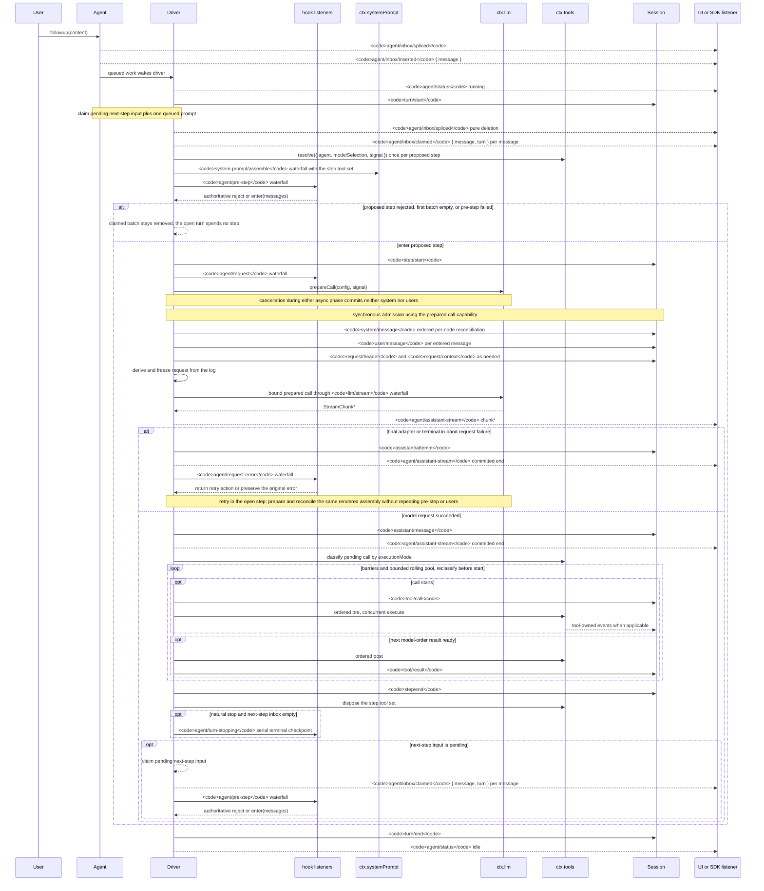

# エージェントのターンとステップのライフサイクル

日本語 | [English](../../docs/agent-lifecycle.md) | [中文](../../docs/agent-lifecycle.zh.md)

> これは非公式の日本語訳です。英語版（[docs/agent-lifecycle.md](../../docs/agent-lifecycle.md)）が正です。翻訳時点: 2026-10-31、upstream commit `ce7073d51254c26cd63b22a60835b8f948deb447`。
>
> Mermaid 図のイベント名・参加者名はコード識別子との対応を保つため原文のままです。図の生成元は `scripts/gen-doc-graphs.ts` です。

このシーケンスは、[architecture.md](architecture.md#ターン・フロー)の視覚的な補助資料です。永続的なリプレイ事実は `session/event` に、ライブな制御・状態は `agent/*` に置きます。

`assistant/message` イベントは、内容なしの完了や `max-tokens` での完了を含む、すべての成功したプロバイダー呼び出しを記録し、正確なコンパクトな timed stream を埋め込みます。空の内容は派生履歴に残りません。失敗、リトライ、キャンセル、ストリーム・エラーの試行が、surface メッセージなしで決着に到達した場合は、そのストリームを `assistant/attempt` として記録します。ライブな `agent/assistant-stream` の chunk フレームは一時的です。リプレイはどちらかの永続的な決着を読み、決着前のハードなプロセス損失は永続的な attempt ストリームを残しません。

`dsh-compaction-basic` は、リクエスト派生前の圧力に対して `agent/pre-step` を、正規のコンテキスト溢れに対してのみ `agent/request-error` を使います。どちらかのトリガーが条件を満たすと、オプションのツール結果 pruning が要約選択の前に実行されます。回復は開いているステップ内で実行され、pruning または要約が surface 置換の世代を進めた場合にのみリトライします。それ以外の場合は、元のリクエスト・エラーが権威あるものとして残ります。各リトライは、組み立て、pre-step、ユーザー受付を繰り返さずに、呼び出しを準備し、保持されたレンダリング済み組み立てをリクエスト派生前に調整します。

返された `agent/pre-step` の判断は権威があります。`next()` をラップするリスナーは、置換が意図されていない限り、下流のメッセージと `startsRequestSeries` を保持します。ステアリングと注入されたコンテキストは、後の claim 操作が次のステップ・バッチを取得した後、同じウォーターフォールを通ります。

リプレイ可能な transcript データを必要とする SDK ユーザーは `session/event` を消費してください。`agent/*` は、キュー・状態、プロンプト傍受、リクエスト構築、ステアリング、継続、エラーのためのライブ・コーディネーション API です。

メンテナンス・モード: 厳選された Mermaid シーケンスです。正確なイベント署名は、生成された Cordis カタログにあります。
