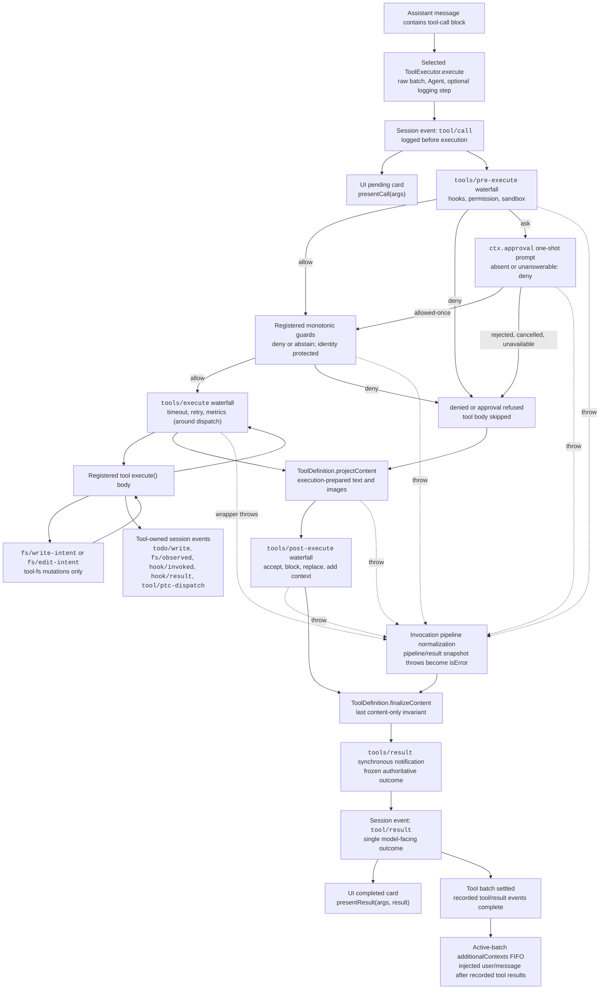

# ツール実行パイプライン

日本語 | [English](../../docs/tool-execution-pipeline.md) | [中文](../../docs/tool-execution-pipeline.zh.md)

> これは非公式の日本語訳です。英語版（[docs/tool-execution-pipeline.md](../../docs/tool-execution-pipeline.md)）が正です。翻訳時点: 2026-10-31、upstream commit `ce7073d51254c26cd63b22a60835b8f948deb447`。
>
> Mermaid 図のイベント名・識別子はコードとの対応を保つため原文のままです。図の生成元は `scripts/gen-doc-graphs.ts` です。

組み込みエグゼキューターは、生バッチの解析、スケジューリング、キャンセル、セッションの call/result ログを所有します。この図は、共有された呼び出しパイプラインが、ループを変えずに、ポリシー、フック、サンドボックス、ファイルシステム・ガード、結果の書き換え、最終結果の観測、UI レンダリングをどこで適用するかを示します。最初に `tools/pre-execute` ウォーターフォールが走り、次に単調ガード、その後に `tools/execute` と `tools/post-execute` のウォーターフォールが続きます。3つのウォーターフォールは呼び出しを変換できます。定義が所有する `projectContent` は post-execute の前に準備済みコンテンツを設定し、`finalizeContent` と `tools/result` はその後に走ります。

ファイルシステムの read-before-edit チェックは、`fs/*` イベント上の `tool-fs` より下に留まります。汎用の pre/post ウォーターフォールはフックと承認ポリシーをホストします。`ctx.approval` は単調ガードの前に ask を解決し、並べ替えてはならないオーナー・ポリシーは登録済みガードのままです。タイムアウトのような around ディスパッチの関心事は `tools/execute` をラップします。パイプラインは候補結果をロスレスにスナップショットし、スナップショット失敗を正規化してから、可視定義のスナップショット済み `finalizeContent` コールバックが同期的なコンテンツのみの不変条件を強制します。その後 `tools/result` が、不変でロスレス JSON の結果を観測します。これにより、フックはツールを1つのポリシー・サービスに結合せずに、ツール・ファミリーをまたげます。PTC モードは、予約された `run_code` トランスポートとその順序付きサブコールの両方をパイプラインに通します。サブコールは親トークンを運び、`tool/ptc-dispatch` をログし、拒否をバインディング拒否として返し、call/result の隣接性を保つために `additionalContexts` を省略します。

メンテナンス・モード: 厳選された Mermaid フローです。正確なツール・スキーマとイベント署名は、生成されたカタログにあります。
